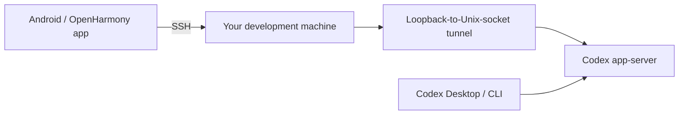

# Android SSH Codex

**Use Codex on your development machine from an Android or OpenHarmony device.**

[](https://github.com/wkj2333666/Android-SSH-Codex/releases/latest)
[](https://github.com/wkj2333666/Android-SSH-Codex/actions/workflows/ci.yml)
[](https://github.com/wkj2333666/Android-SSH-Codex/actions/workflows/build.yml)
[](LICENSE)

Android SSH Codex is a mobile client for a Codex app-server running on a
computer you control. It connects directly over SSH—there is no hosted relay,
no Codex runtime on the phone, and no need to copy your OpenAI credentials into
the app.

### Background connections on Android

While connecting or connected, Android shows an ongoing **Codex connection active**
notification. A foreground service and CPU wake lock help keep the SSH connection
alive when switching apps or turning off the screen. Allow notification permission
when prompted. Tap the notification to return to the app; use **Disconnect** to
stop the service and release its wake lock. Removing the app from recent tasks
does not intentionally disconnect an active session. It does not restart itself
after force-stop or reboot.

This uses additional battery. Network changes, Android power-saving modes and
manufacturer restrictions can still interrupt the connection; automatic recovery
remains available. If Android denies service startup or notification permission,
the app displays a warning. OpenHarmony behavior is unchanged.

Battery-optimization exemption and unrestricted background data are separate
settings. Neither guarantees that a VPN or changing mobile network stays alive.
SSH reply timeouts detect unresponsive transports without depending on model
response time; a timeout is not proof of which network component failed.

### File downloads

Android downloads use a dedicated SSH/SFTP connection with bounded parallel
reads, a 1 GiB size limit, speed/progress display, and cancellation. Downloads
retry transient failures up to three times within the current operation and
resume from written bytes only when the remote SHA-256 still matches. Completed
content is verified before opening the phone save picker. Resuming after app
process death is not supported. Missing SFTP support or checksum tools produces
an error rather than silently falling back to slow per-block shell commands.

The Android service declares the `specialUse` type for interactive SSH sessions,
not media playback or periodic data sync. Google Play distribution requires the
corresponding foreground-service declaration and review; GitHub APK releases do
not imply Play approval.

> [!NOTE]
> This is an independent community project. It is not affiliated with or
> endorsed by OpenAI.

## What you can do

- Browse tasks by remote project, with unassigned tasks kept out of the way.
- Use **Manage tasks** for paginated server search, pinned tasks and archived
  tasks. Rename, pin/unpin, archive and restore without deleting conversations.
  Pinning requires a server that supports persisted `isPinned` metadata.
- Fork a conversation from its menu, or use a message's **⋯** / long-press to fork through
  that turn or revert from it. Revert removes that turn and later conversation
  history, **not file changes**; it requires an idle, paginated thread. Fork
  first to keep a copy. Older servers may not support these operations.
- Start new tasks and continue existing Codex Desktop or CLI conversations.
- Follow streaming responses, approvals, tool activity, Markdown, and formulas.
  Expanded work events have a height limit and their own scrollbar; the collapse
  header stays outside the scrolling tool/reasoning details.
- Choose a server-advertised model and reasoning effort for new turns. The
  model panel also offers **Fast** when the server advertises support. Fast
  uses more quota/credits; it applies to new turns (including queued messages),
  not to a turn already running. Turning it off requests standard speed.
  The model panel shows the connected server account's remaining subscription
  quota and reset times when provided, with live updates and manual refresh.
  API-key/custom providers without quota support show **Usage unavailable**,
  not unlimited usage. Percentages are quota windows, not remaining messages.
- Browse cached tasks, select cached models, and keep typing while disconnected.
  Attachments picked offline wait for the same host to reconnect before uploading;
  they can still be removed. Text and already-uploaded attachments can be queued
  offline; pending uploads must finish before submitting their message.
  Draft text, model settings, and attachments are kept separately per host and
  task and saved in secure local storage. Leaving a task does not cancel its uploads.
  Failed uploads remain available to retry from the same resumable target.
  Drafts, attachment upload targets and queued messages survive process restarts.
  Explicit disconnect retains the queue and stops automatic reconnect.
  Messages whose delivery was interrupted are marked **Delivery unknown** and
  are not automatically resent: check the conversation before retrying or removing
  them. The protocol does not provide exactly-once submission guarantees.
  Conversation history itself is still an in-memory cache, not a full offline archive.
- Send follow-up instructions to a working agent; messages are steered to the
  active turn or queued when the turn is changing state.
  The composer delivery menu offers **Auto**, **Steer** (guide the current turn
  immediately, bypassing queued messages), and **Queue** (send when idle).
  Queued messages also have a visible **Steer** button. Explicit Steer requires
  an active turn and does not silently start a new one.
- Use `/goal`, `/compact`, `/skills`, `/interrupt`, and remote skill completion.
  An existing goal has a compact progress row above the composer. Tap to edit,
  or pause/resume using its button; status changes preserve accumulated usage.
- Open very long conversations without loading the entire history at once.
- Reconnect automatically to the last host unless you explicitly disconnect.
- Import common OpenSSH configuration, including a one-hop `ProxyJump`.

The app uses a responsive Material 3 interface and supports both phone and
tablet layouts, light and dark themes, password authentication, and pasted
OpenSSH private keys.

## How it works



Codex, source code, provider credentials, and command execution stay on the
remote development machine. The mobile app carries app-server RPC traffic over
an SSH exec channel and renders the resulting tasks and events.

## Requirements

### Mobile device

- Android 8.0 or newer, or a compatible OpenHarmony device.
- Network access to the SSH server.

### Development machine

- A reachable SSH server that allows session and exec channels.
- `/bin/sh`, `base64`, and a writable home directory.
- For file downloads: an enabled SFTP subsystem, `head`, and `sha256sum`.
- Codex CLI installed and authenticated on that machine.
- Codex CLI 0.146.0 or newer for automatic **Shared** mode startup. Use a current
  release whenever possible.

The phone does not need the Android SDK, Flutter, Codex credentials, or direct
access to your source repository.

Codex is resolved in the SSH command environment, which may differ from your
interactive terminal. The app honors an existing `codex` on `PATH` first. If it
is missing, Shared startup, the proxy, and Isolated startup first run an isolated
`bash --noprofile -ic` probe to read the SSH user's `.bashrc` PATH (including
interactive-only setup). Only PATH and the resolved executable are imported;
aliases/functions and other shell variables are not. Startup output is discarded
and stdin is disconnected from the proxy. Bash and `timeout` are required for
this optional probe, which is bounded to approximately five seconds.
If probing fails or is unavailable, the app checks
`CODEX_INSTALL_DIR` (when set), the provider-switcher wrapper directory,
`~/.local/bin`, `~/bin`, `~/.npm-global/bin`, `~/.local/share/pnpm`,
`~/.bun/bin`, and `~/.codex/packages/standalone/current/bin`.
These fallback directories are added to the child process PATH. Your server
configuration is not modified. `.bashrc` runs only inside the separate probe,
not inside the long-lived proxy or daemon process.

## Install

Download the latest build from
[GitHub Releases](https://github.com/wkj2333666/Android-SSH-Codex/releases/latest):

- `app-arm64-v8a-release.apk` — most current Android phones and tablets.
- `app-armeabi-v7a-release.apk` — older 32-bit Android devices.
- `app-x86_64-release.apk` — x86_64 devices and emulators.
- `android-ssh-codex-ohos-arm64-unsigned.hap` — native OpenHarmony build.

Download `SHA256SUMS-android.txt` or `SHA256SUMS-ohos.txt` with the matching
package, then verify it with:

```bash
sha256sum -c SHA256SUMS-android.txt --ignore-missing
```

Install or update an Android build over ADB with:

```bash
adb install -r app-arm64-v8a-release.apk
```

The Android packages use a retained release certificate and support in-place
upgrades. Builds through `v0.1.4` used temporary CI certificates, so users
upgrading from one of those versions must uninstall it once before installing a
current release.

The native OpenHarmony HAP is unsigned. Devices that require a distributor
certificate and provision profile must have the HAP signed before installation.
HarmonyOS devices with Android compatibility can use the Android APK instead.

## Connect your first host

1. On the development machine, confirm that SSH and Codex work normally:

   ```bash
   codex --version
   codex # Complete sign-in if prompted, then exit.
   ```

2. In the app, open **Hosts**, select **Add SSH host**, and enter the SSH host,
   user, port, and authentication method. Leave the app-server mode on
   **Shared** for the usual Codex Desktop-compatible setup.
3. Connect and compare the displayed SSH host-key fingerprint with the trusted
   fingerprint from your server before accepting it.
4. Open **Tasks**, add a project using its absolute working directory on the
   development machine, and start or resume a task.

The app remembers an intentional connection and reconnects after restart or a
temporary network failure. Using **Disconnect** clears that intent.

### Shared projects

Projects are stored on the connected Codex server using its project APIs.
Android reads the shared list on connection, manual refresh, server change
notifications, and the foreground refresh cycle. Creating, renaming, changing a project's directory, or deleting
a shared project updates the same records used by compatible Desktop clients.
Both clients must connect to the same host and Codex data store; a Desktop
version that only uses its own local folder list cannot display this registry.
In particular, this does not automatically add a remote folder to a separate
Desktop installation's sidebar. Add that remote folder on Desktop once; Android
does not edit another computer's private Desktop settings.

Tasks started inside a project carry its shared project ID. The **Tasks** view
also shows tasks outside projects. On the first connection after upgrading,
manually saved Android projects are imported, matching an existing shared
project by directory when unambiguous. Unassigned, non-archived tasks in that
exact directory are attached; tasks already assigned elsewhere are preserved.
Automatically discovered directory groups are not bulk-imported: those tasks
remain available in **Tasks** and **Unassigned** until you add their project.

Deleting a shared project removes the project for all connected clients, but
keeps its files and tasks. Older servers without project APIs can still show
task history; update remote Codex to create or edit shared projects.

## App-server modes

Every saved host has an explicit app-server mode:

| Mode | Use it when | Behavior |
| --- | --- | --- |
| **Shared** | You want the same task state as Codex Desktop or other local clients. | Starts or reuses the Codex-managed daemon for the effective `CODEX_HOME`. This is the default and recommended mode. |
| **Custom** | You already manage an app-server socket. | Connects to an absolute Unix socket path and never starts, restarts, or stops its process. |
| **Isolated** | You want a mobile-only app-server lifecycle. | Manages a separate socket under the remote cache directory and restarts only that app-owned process when its environment changes. |

The selected mode is authoritative. A connection failure never silently falls
back to another daemon or socket.

## SSH configuration

You can paste relevant `~/.ssh/config` contents into the host editor. The
importer understands:

- `Host`, `HostName`, `User`, and `Port`
- `IdentityFile`
- `SetEnv`
- wildcard and negated host patterns
- one-hop `ProxyJump`
- `ConnectTimeout` (1–120 seconds), `ServerAliveInterval` (0–300 seconds)

Under **Advanced SSH**, enable **Use jump host** to add or edit a jump host
without importing a config. Supply its address, user, port and independent
password/private key/passphrase; it forwards TCP to the target, not a shell
command. Both hosts verify their keys separately. Changing the jump endpoint
requires confirming its new key; turning it off clears its saved credentials.
The jump server must allow TCP forwarding to the target.

Per-host connection and authentication timeouts (1–120 seconds) and keepalive
interval (0–300 seconds) are editable there too. Defaults remain 15, 20 and 15
seconds. A zero keepalive interval disables periodic pings, not explicit health
checks. Options apply to both SSH legs; long setup budgets account for both.
Changes take effect on the next connection, including attachment transfers.

An imported `IdentityFile` path is only a hint: the file usually exists on the
computer where the SSH config came from, not on the phone. Paste the key into
the host profile or use password authentication.

Environment variables can be entered under **Advanced SSH**, one `NAME=value`
assignment per line. The SSH server must allow each requested name with
`AcceptEnv`. For example:

```text
# Mobile host profile
MY_VARIABLE=value
```

```text
# Remote sshd_config
AcceptEnv MY_VARIABLE
```

Reload the SSH server after changing `sshd_config`. If a name is rejected, the
app reports the required `AcceptEnv` entry without revealing the configured
value. Arbitrary OpenSSH directives are not executed by the app.

## Security and privacy

- All app-server traffic travels directly through your SSH connection.
- Host keys are pinned on first use; a changed key produces a hard warning.
- Passwords, private keys, and fingerprints use platform secure storage.
- The app never requests or stores OpenAI provider credentials.
- SSH input and Codex RPC input are not written to application logs.
- Isolated-mode reuse stores only a SHA-256 environment fingerprint, not the
  environment values themselves.

Please report vulnerabilities privately as described in
[SECURITY.md](SECURITY.md). Do not post credentials, private keys, hostnames, or
app-server traffic in public issues.

## Troubleshooting

### Send images and files (Android)

In an existing task, tap the paperclip beside the message box and choose **Image**
or **File or video**. Images have a preview; tap a chip to enlarge an image, or its remove
button to discard it. You can send attachments with or without accompanying text.
Limits: 4 attachments per message and 1 GiB per file. Selection is streamed to
an app cache file and immediately uploaded over a dedicated SSH/SFTP connection,
so large files are not retained in Dart or Kotlin memory. The attachment chip
shows upload progress; an interrupted upload reconnects and resumes from the
remote acknowledged offset. Upload progress repaints only the attachment chip,
so the message editor remains usable; an uploading attachment can be removed to
cancel its transfer. Tap a failed attachment to retry from that offset.
PNG, JPEG, WebP and GIF are accepted as images (up to 64
megapixels and 16,384 pixels per side); other formats can be sent
as files. Queued messages and steering preserve image attachments.
Videos must be selected with **File or video**. They are uploaded as the original remote
file, labeled as video with its media type, and never sent as native image
inputs. Video understanding depends on the agent's remote tools and codecs;
this client does not turn a video into model-native video input or extract
frames automatically. If a document provider returns only an image thumbnail
instead of the video, selection is rejected; choose the original file instead.

Sent images, native MCP/dynamic-tool image results, and remote Markdown images
in replies appear as bounded inline thumbnails without a save dialog. Tool
image previews stay visible outside collapsed work events; raw image Base64
is not printed in tool details. External HTTP images remain blocked. Tap a
thumbnail to zoom; if loading fails, use Retry. Only mounted timeline images
are requested, and inline remote previews remain capped at 10 MiB.
Question prompts and answer options support Markdown formatting.

Selecting a file uploads it into a private, randomly named directory under
`~/.local/share/android-ssh-codex/attachments/` on the selected host. Sending the
message reuses that completed upload without transferring the file again. Images
are sent as native image inputs; other files are provided
to the agent by remote path, subject to its file-access and format support.
Uploads are retained for conversation references; remove them manually when no
longer needed. Removing an attachment after upload may leave an unused remote
copy there.
This version does not add camera capture or an OpenHarmony
file picker. Attachment names and contents are excluded from diagnostic logs.

### The SSH connection works, but Codex does not connect

Update Codex on the development machine and confirm that the selected mode is
available. For **Shared** mode, Codex CLI 0.146.0 or newer is required to start
the managed daemon. For **Custom** mode, verify that the configured absolute
Unix socket exists and belongs to a running app-server.

### The server rejects an environment variable

Either remove it from **Advanced SSH** or add its name to `AcceptEnv` in the
server's `sshd_config`. Configure names only—never put secret values in
`sshd_config`.

### The host key changed

Do not accept the new fingerprint until you have verified the change through a
trusted channel. An unexpected key change can indicate a rebuilt server, a DNS
or address change, or an interception attempt.

### Download files and answer questions

Downloads show received bytes and a percentage when the remote file size is
available. Errors distinguish missing files, directories, read permissions,
transfer timeouts and phone save failures. Diagnostic logs record the failing
stage without recording file paths or contents.

On Android, tap a file link in an agent reply (absolute remote paths,
`sandbox:/…`, `file:///…`, or project-relative paths), confirm the download,
then choose a save location in the system picker. Attachment cards also have a
Download action. Files use a dedicated resumable SSH/SFTP connection, with a
1 GiB limit; temporary copies are removed
after saving, cancelling or failure. HTTP/HTTPS links still open in your browser.
Remote files must exist on the connected SSH host; links to a different sandbox
cannot be downloaded through this connection.

Blocking structured questions appear above the composer. Select an option or
enter a custom answer when offered, then submit; nothing is automatically
selected or submitted. Skip submits empty answers. Prompts disappear when
resolved by another client and are cleared on disconnect, so an old prompt
cannot answer a new connection's request. Newer asynchronous Codex questions are
rendered inside the agent message with choice buttons and an editable answer
field; submitting starts or steers the next user message as appropriate.

### Collect Android logs

The bug icon opens **Connection diagnostics**, with **Export connection diagnostics**
and **Clear connection logs** actions. Clearing requires confirmation and removes
only the app's current and rotated diagnostic logs, not chats, hosts or exported
files. New events continue to be recorded. Tablet/wide layouts use a compact
72 dp navigation strip to leave more space for conversations.

For background disconnects, use **Export connection diagnostics** in that menu
in the app's top bar (sidebar on wide screens). Logging is automatic on Android:
unplug USB, reproduce the issue, return to the app, and export to a text file
using the system document picker. Export works while disconnected too.

The app keeps two rotating files of about 512 KiB each in private storage,
surviving app restarts. They contain timestamps, process/lifecycle/service state,
connection attempts, RPC timeouts, error types and OS error codes—not chat text,
RPC payloads or SSH credentials. Bootstrap failures additionally include a bounded
excerpt of remote command output, with configured environment values and common
credential patterns redacted. These excerpts may contain remote file paths or
hostnames. Nothing is uploaded automatically. Review exported files before
sharing. Clearing app storage removes
the private logs (and other app data); exported copies remain where you saved them.
Logging is best-effort: abrupt process termination can lose the latest events.

Disconnect records include nested SSH/socket error types, Android errno categories,
the connection attempt and SSH hop, explicit local-close reasons, and proxy exit
codes/signals with allowlisted stderr categories. Native network callbacks record
default-network loss/replacement, validation and blocked status; power/data-saver
changes and a network/power snapshot accompany transport failures. These records
do not include IP addresses or Wi-Fi names. A TCP reset does not prove
who caused it, and power saver being enabled does not prove it caused a disconnect.
When no cause is available (for example EOF without an error), the log says so
instead of inventing a diagnosis. Android versions before 10 do not provide the
network blocked-status callback.

For additional Android system logs (these may contain sensitive information):

Reproduce the problem, then run:

```bash
adb logcat -d -v threadtime \
  | grep -E 'Connection failed during|Remote Codex Unix tunnel failed|I/flutter'
```

Remove hostnames and any other private information before attaching logs to an
issue. The app intentionally avoids logging SSH and RPC input.

If the problem persists,
[open an issue](https://github.com/wkj2333666/Android-SSH-Codex/issues) with
the app version, phone OS, Codex CLI version, selected app-server mode, and
sanitized logs.

## Current boundaries

Android SSH Codex is a remote Codex workspace, not a complete mobile
development environment. It does not:

- run Codex or shell commands locally on the phone;
- provide a source-code editor or Git hosting client;
- proxy traffic through a project-operated cloud service;
- support multi-hop `ProxyJump` chains;
- sign the native OpenHarmony HAP.

## Build and contribute

Issues and pull requests are welcome. Please read
[CONTRIBUTING.md](CONTRIBUTING.md) before making broad product or protocol
changes.

GitHub Actions is the authoritative build environment. It runs formatting,
analysis, tests, Android builds, Android signature verification, and
OpenHarmony builds. See [docs/BUILDING.md](docs/BUILDING.md) for pinned
toolchains, build outputs, and release-signing details.

## License

Android SSH Codex is available under the [MIT License](LICENSE).
